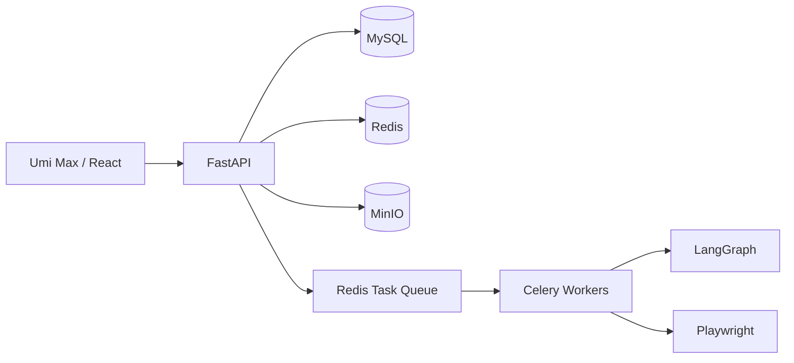

<div align="center">

# Tree Creative

**Private · Proprietary · Production-grade**

面向长期演进的智能化业务平台。

</div>

> [!IMPORTANT]
> 本仓库包含专有商业代码与内部资料。未经授权，不得复制、传播、部署或向第三方披露。

## 项目概览

项目当前处于基础设施与架构初始化阶段。产品定位、业务范围和需求文档将在正式立项后补充。

| 项目 | 当前状态 |
| --- | --- |
| 产品定义 | 待补充 |
| 系统架构 | 技术基线已确定，详细设计待补充 |
| 开发环境 | 待脚手架完成后开放 |
| UAT | 本机 Docker，待部署配置完成 |
| Production | `server244` Docker，待部署配置完成 |

## 技术架构



详细技术约束参见 [技术栈基线](agent-guides/tech-stack.md)。

## 目录规划

```text
tree-creative/
├── frontend/           # Umi Max 前端应用（待初始化）
├── backend/            # FastAPI 后端应用（待初始化）
├── deploy/             # Docker Compose 与环境部署配置（待初始化）
├── scripts/            # 可重复执行的工程与运维脚本（待初始化）
├── tests/              # 跨服务与端到端测试（待初始化）
├── agent-guides/       # Agent 必读规范
└── .github/            # GitHub 协作、治理与 CI/CD 配置
```

目录会随脚手架落地创建；本节是约定，不代表对应模块已经可用。

## 快速开始

开发命令将在前后端脚手架初始化后补充，并必须保证从全新环境可重复执行。

| 操作 | 命令 |
| --- | --- |
| 安装依赖 | 待定义 |
| 启动开发环境 | 待定义 |
| 运行测试 | 待定义 |
| 代码检查 | 待定义 |
| 构建 | 待定义 |
| 启动 UAT | 待定义 |

## 工程规范

- 所有开发任务开始前必须阅读 [开发八荣八耻](agent-guides/development-principles.md)。
- 技术选型与架构边界以 [技术栈基线](agent-guides/tech-stack.md) 为准。
- Agent 协作规则以 [AGENTS.md](AGENTS.md) 为准。
- 贡献、分支、提交和评审流程参见 [CONTRIBUTING.md](CONTRIBUTING.md)。
- 所有行为变更必须有与风险相称的自动化验证。

## 交付环境

| 环境 | 基础设施 | 用途 | 发布方式 |
| --- | --- | --- | --- |
| Development | 本机进程或 Docker | 日常开发 | 开发者本地执行 |
| UAT | 本机 Docker | 验收与集成验证 | 独立 Docker Compose 项目 |
| Production | `server244` Docker | 正式服务 | GitHub Actions 门禁后的受控部署 |

环境必须使用独立配置、凭据、数据卷、网络和 Compose 项目名。生产发布必须使用可追溯的版本化镜像。

## 安全

不要在 Issue、日志、提交记录或仓库文件中暴露凭据和敏感数据。发现安全问题时，按 [SECURITY.md](SECURITY.md) 进行私密报告。

## 变更与发布

重要变更记录在 [CHANGELOG.md](CHANGELOG.md)。发布版本、数据库迁移、健康检查和回滚必须作为同一交付流程设计。

## 许可与保密

本项目为专有软件，未授予任何公开使用许可。详见 [LICENSE](LICENSE)。
